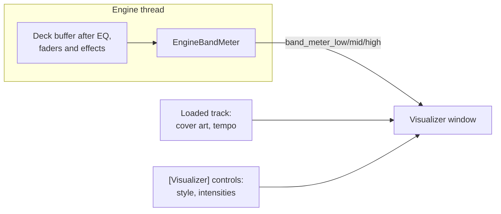

# Visualizer Window

* **Owners:**
  * `@terziev-viktor`

* **Implementation Status:** `Not implemented` (a working prototype exists on @terziev-viktor's fork, see the below PR)

* **Related Issues and PRs:**
  * PR <https://github.com/mixxxdj/mixxx/pull/17499>
  * Feature request <https://github.com/mixxxdj/mixxx/issues/17500>

* **Other docs or links:**

> TL;DR: Add a separate, control-free window for a projector or a second screen that shows visuals based on
> the lows, mids and highs that leave the mixer. It touches the audio engine (a new
> per-deck band meter), adds a window with two shaders to the legacy user interface, adds a control group
> `[Visualizer]` and a section in the LateNight skin settings.

## Why

DJs who play with a projector or a screen that faces the audience have nothing to show there from Mixxx

Mixxx knows things about a set that no other program on the computer knows: which tracks are loaded, their cover art
and tempo, and what each deck contributes to the mix after the equalizer, faders and effects. Visuals
built on this follow what the DJ does, with no extra setup and no second program to operate.

### Pitfalls of the current solution

Today a DJ who wants visuals runs a separate visualizer next to Mixxx. In that setup:

* It needs its own audio routing which is one more thing to set up and to fail during a gig.
* It is a second program to watch while mixing.

## Goals

Goals and use cases for the solution as proposed in [How](#How):

* A DJ can put one window on a second screen, make it full screen and leave it alone for the whole set.
* The window shows nothing but visuals - based on the cover art of the audible tracks, or a custom image selected by
  the DJ
* The DJ can limit how strongly lows, mids and highs affect the visuals.
* The feature costs nothing in the audio engine while the window is not shown.
* More visual styles can be added later without changing the controls or the engine.

### Audience

DJs who play live with a second screen facing the audience.

## Non-Goals

* A general visualization framework with presets or scripting, such as a host for MilkDrop presets.
* Video mixing, video playback or output to video hardware.
* Support for the QML user interface in the first version.
* Skin widgets for skins other than LateNight in the first version. The other skins get the menu entry and the
  controls.
* Samplers, microphones, auxiliary inputs and preview decks as sources of the visuals.
* Synchronizing the visuals to the beat grid. The first version uses the tempo only.
* Remembering the position of the window or choosing the screen for it. The window manager is used for that.

## How

### Overview

### 1. Per-deck band meter in the engine

A new class `EngineBandMeter` measures how much lows, mids and highs of each deck contributes to the main mix. `EngineMixer`
feeds it with the buffer of each deck after the crossfader buses are mixed. At that point the buffer has passed the
equalizer, the volume fader, the crossfader and the post-fader effects.

* The levels are published as read-only controls `band_meter_low`, `band_meter_mid` and `band_meter_high`,
  with the mean absolute sample value of the band as value.
* The meter uses the existing `EngineFilterLinkwitzRiley4` filters. Designing such a filter allocates memory, so the
  filters for the common sample rates are designed when the meter is constructed. Nothing is allocated in the audio
  callback.
* The meters only run while they are requested

### 2. Visualizer window

A top-level `WGLWidget` that is driven by the frame clock of the waveforms, like the spinning vinyl widgets. It is
opened with a new entry in the View menu.

* **One deck audible:** the cover is shown at 80 % of the window in front of a blurred, dimmed copy of itself that
  fills the window. Bass bulges the cover, mids swirl it and highs add ripples and color fringes. The blurred copy
  flows at the tempo of the deck.
* **Several decks audible:** the covers are combined into one square picture, which is then treated like a single
  cover. Each deck reveals a part of its cover art, and the area of that part equals the share of the deck in the mix.

  | Audible decks | Layout of the combined picture |
  |---------------|--------------------------------|
  | 2             | left and right                 |
  | 3             | three wedges that meet in the middle |
  | 4             | four quarters                  |

* **Effect per band:** the intensity that the DJ has set, multiplied by the level of the band. With either of them at
  zero the band has no effect.
* Covers are scaled and blurred in a worker thread, and only while the window is shown.

### 3. Controls

| Control | Purpose |
|---------|---------|
| `[Visualizer] show_window` | Shows or hides the window. |
| `[Visualizer] style` | Selects the style: Cover Distortion, or Custom Image, which shows an image chosen by the DJ in place of the covers. |
| `[Visualizer] select_image` | Opens the dialog to choose that image. |
| `[Visualizer] bass_intensity`, `mid_intensity`, `high_intensity` | The maximum effect of each band, 0 to 1. |
| `[ChannelN] band_meter_low`, `band_meter_mid`, `band_meter_high` | The band levels of a deck, read-only. |
| `[App] band_meters_enabled` | Switches the band meters on for mappings and skins. |

## Alternatives

1. **Derive the levels from the analyzed waveform.** The waveform data already has low, mid and high values per
   position, and the scrolling waveforms scale them with the equalizer knobs. This needs no engine code. It was not
   chosen because it does not see the volume fader, the crossfader, the filter knob or other effects, it shows
   nothing for vinyl or line input, and its bands do not match the equalizer.

2. **Analyze the main mix instead of each deck.** One meter instead of four. It was not chosen because the visuals
   could then not tell the decks apart, which is what allows special animations during track transitions

3. **Leave visuals to external programs and only export data,** for example over OSC or MIDI. This keeps Mixxx
   smaller and is still possible with the new band level controls. It does not serve the DJ who wants visuals
   without setting up a second program, which is the main use case here.

4. **Embed an existing visualization library,** such as projectM. This offers many presets, but adds a large
   dependency, and such presets react to the summed audio only and know nothing about decks.

5. **A widget inside the skin instead of a window.** A widget cannot be moved to a second screen and shares the
   space of the main window with the controls.

## Action Plan

* [ ] Agree on this proposal
* [ ] Pull request: per-deck band meter and its controls in the engine.
* [ ] Pull request: move the cover art tracking of `WSpinnyBase` into a shared helper.
* [ ] Pull request: visualizer window, the `[Visualizer]` controls and the View menu entry.
* [ ] Pull request: "Visualizer" section in the LateNight skin settings.
* [ ] Pull request for the manual: the new controls and a section about the window.
* [ ] Test on Windows and macOS, and with graphics hardware from other vendors.
