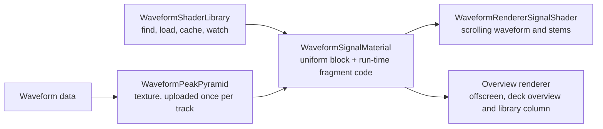

<!-- [AI-generated by Claude — start] -->

# Waveform Shader Packages

* **Owners:**
  * `@v1vendi`

* **Implementation Status:** `Partially implemented` (working prototype, not yet proposed as PRs)

* **Related Issues and PRs:** see [Related work](#related-work) for the full list.
  * Bug fixes found while building this, independent of the proposal:
    [v1vendi/mixxx `fix/allshader-hsv-and-stem-gain`](https://github.com/v1vendi/mixxx/tree/fix/allshader-hsv-and-stem-gain)
    (the AllShader HSV renderer ignores the hue of the low color; the AllShader stem renderer applies the overall gain
    twice)
  * Overview of open waveform issues: mixxxdj/mixxx#15537

* **Other docs or links:**
  * Prototype branches (to be pushed to v1vendi/mixxx): `pr/waveform-shaders`, `feature/overview-shaders`,
    `experiment/drop-legacy-waveforms`

> TL;DR: Draw the AllShader waveform signal with small GLSL fragment shaders ("shader packages") that Mixxx loads from
> disk at run time, instead of one C++ renderer per waveform type. The stock looks (RGB, HSV, Filtered, RGB Stacked,
> stems, high detail, slip) ship as packages and look the same as today. Skins and users can add their own looks
> without recompiling Mixxx, and saving a shader file reloads it while Mixxx runs. The same packages draw the scrolling
> waveform, the deck overview and the library waveform column, and one setting switches all of them at once. The
> prototype is about 4,000 added lines; this document proposes landing it as 7 PRs in a fixed order: stock behavior
> stays unchanged until users can choose packages, a separate PR makes them the default, and a last PR removes the
> legacy waveform code (about 6,400 lines).

## Why

A new waveform look today means a new C++ renderer class, a new waveform type in the factory and preferences, and a
new Mixxx release. That is why only a handful of looks exist, why skins can only pick colors, and why many requests
for other looks stay open (see [Related work](#related-work)). Several open PRs each add one more C++ waveform type.

The AllShader renderers without high detail, and the HSV, Simple and stem renderers, build vertex geometry on the CPU
for every pixel column of every frame. The high detail RGB, Filtered and Stacked types already read the waveform from
a texture (`WaveformRendererTextured`, mixxxdj/mixxx#13151), but that renderer is a port of the legacy GLSL code with
one hard-coded shader per type and no OpenGL ES support. In the prototype, one fragment shader path that reads a peak
texture draws all types, with less work than either:

| Type (1608×59 widget, Apple M1, µs/frame, min) | Stock | Shader |
| ---------------------------------------------- | ----: | -----: |
| rgb                                            |  72.9 |   20.0 |
| rgb high detail (stock: textured)              | 414.3 |   57.8 |
| hsv                                            | 154.0 |   22.9 |
| filtered                                       | 117.5 |   14.5 |
| filtered high detail (stock: textured)         | 294.5 |   43.5 |
| stacked                                        | 119.8 |   14.7 |
| stacked high detail (stock: textured)          | 426.3 |   51.9 |
| stems                                          |  74.2 |   21.2 |

The stock rows without high detail vary between runs, so they are rough.

### Pitfalls of the current solution

* Every look is C++. Skin authors and users cannot change how the signal is drawn.
* The renderers duplicate the same data access, gain and color code per type, with small differences that drift:
  different peak sizes (mixxxdj/mixxx#15322), colors that differ between the scrolling waveform and the overview
  (mixxxdj/mixxx#14813, mixxxdj/mixxx#12449), and the two bugs fixed in the branch above.
* The deck overview and the library waveform column have a third, separate QPainter implementation of the same looks,
  with its own type list and its own gaps (no stacked overview, mixxxdj/mixxx#13265).
* The CPU cost per frame grows with widget width and with high detail.

## Goals

* Draw the AllShader waveform signal with a fragment shader loaded from disk at run time.
* Ship packages that reproduce the stock types (RGB, HSV, Filtered, RGB Stacked, their high detail variants, slip and
  stems). Fewer than 0.02% of pixels differ by more than 10% from the stock renderers for all types except stems,
  which only differ because of the stock gain bug.
* Draw the deck overview and the library waveform column with the same packages.
* **Switch the scrolling waveform and the overviews together.** One choice selects shader packages for the scrolling
  waveform, the stems, the deck overviews and the library column. There is no state where some of them use packages
  and others do not.
* A small, versioned, documented package contract (`contract: 1`) that skin authors can rely on.
* Let a skin choose a package and set its parameters, and let the user override the choice in Preferences.
* Reload a package when its file is saved.
* Keep stock behavior unchanged until the user or the skin chooses packages, and make them the default only in a
  separate step.

### Audience

Skin authors, users who want a different waveform look, and the maintainers of `src/waveform`, `src/rendergraph`,
`src/widget/woverview.*` and the library overview column.

## Non-Goals

* Vertex shaders, geometry or multiple passes in packages. A package only colors pixels.
* Drawing beats, cues, loops, the play marker or other marks with packages. Mixxx still draws them on top.
* Support for the scene graph (QML) backend in the first steps. Run-time compiled shaders need the OpenGL rendergraph
  backend. With the scene graph backend, the built-in shader is used (see [Open questions](#open-questions)).
* A package store, sharing or download inside Mixxx.
* Removing the per-type AllShader renderers (`WaveformRendererRGB`, `WaveformRendererTextured` and the others). They
  stay as `SignalShader off` until packages have been the default for a release; see
  [Follow-ups](#follow-ups-separate-decisions).

## How

### Overview

* `WaveformPeakPyramid` uploads the track's waveform once, as a texture with per-band peaks at every power-of-two zoom
  level. Each frame only sets uniforms (position, zoom, gains, colors, beat, time).
* `rendergraph::WaveformSignalMaterial` defines the uniform block in one place and compiles fragment code at run time
  on the OpenGL backend. If a package fails to compile, it falls back to the built-in `waveformsignal.frag`.
* `WaveformShaderLibrary` finds packages in `<settings>/waveforms/`, then `<skin>/waveforms/`, then
  `<resources>/waveforms/` (first match wins). It caches them and reloads them when a file changes.
* A package is a directory with `manifest.json` (name, `contract: 1`, up to 16 float parameters) and `waveform.frag`,
  which implements `vec4 waveformColor(WaveformPixel p)` in GLSL 1.20 / ES 1.00. Mixxx provides the helpers
  (`waveformData()`, `waveformPeaks()`, stem helpers), the `WF_*` uniforms and `main()`. `WF_OVERVIEW` tells a package
  that it draws an overview. The full contract is in `res/waveforms/README.md`.
* The overviews render the package offscreen on one GL thread and draw the result as an image, so `WOverview` keeps
  drawing its marks with QPainter. The image is re-rendered only when the data, size, gain or package changes, and at
  most every 500 ms while a track is analyzed.

### One switch for all waveforms

`[Waveform] SignalShader` selects packages for every waveform at once:

| Value                      | Scrolling waveform and stems          | Deck overviews and library column      |
| -------------------------- | ------------------------------------- | -------------------------------------- |
| not set (stock)            | the skin's package, otherwise stock   | the skin's package, otherwise stock    |
| `off`                      | stock renderers                       | stock QPainter overview                |
| `default`                  | standard package for the waveform type | standard package for the overview type |
| a package name             | that package                          | that package                           |

Rules that keep them in step:

* A skin names its package once, and the overviews use the same one. (The prototype reads `<WaveformShader>`
  separately from the `<Overview>` node; that changes so that a skin cannot select packages for only one of them.)
* If a package is missing or fails to compile, every waveform falls back to the built-in shader, not to the stock
  renderers, so the overviews do not switch back to QPainter while the scrolling waveform stays on shaders.
* Preferences show the setting once, for all waveforms. There is no separate overview switch.
* The user-facing switch only lands once the overviews support packages (PR 4 before PR 5 below).

### Splitting the work

The prototype is 4 commits on top of `main` (about 2,900 added lines) plus 2 for the overviews (about 1,060). The plan
below splits it so that:

* each PR has one main reviewer focus and leaves Mixxx working, with stock behavior unchanged until PR 5;
* each PR is used by Mixxx as soon as it is merged;
* users can only turn packages on once the scrolling waveform, stems and overviews all support them.

| #   | PR                                                                                       | Area                         | Size (approx.)             | Depends on |
| --- | ---------------------------------------------------------------------------------------- | ---------------------------- | -------------------------- | ---------- |
| 0   | Fix AllShader HSV hue and stem double gain                                               | allshader                    | 2 one-liners               | –          |
| 1   | Shader-based signal renderer with the built-in shader, behind a hidden config key        | waveform data, rendergraph, allshader | ~1,250 + tests (3 commits) | –          |
| 2   | Shader packages: contract, `WaveformShaderLibrary`, hot reload, bundled packages, README | allshader, res               | ~650 + ~500 shader/docs    | 1          |
| 3   | Stems through packages (stem pass, `stems` package)                                      | allshader                    | ~300                       | 2          |
| 4   | Overviews and library column drawn with packages, rendered offscreen                     | widget, library              | ~1,080                     | 2          |
| 5   | One user-facing switch: Preferences "Shader" setting and skin `<WaveformShader>`         | preferences, skin            | ~150                       | 3, 4       |
| 6   | Make `default` the default value of `SignalShader`                                       | config                       | ~10                        | 5          |
| 7   | Remove legacy waveforms: non-AllShader types and the QPainter overview                   | waveform, widget, library, preferences | −6,400 / +160 (2 commits) | 6          |

Details:

* **PR 0** is already prepared and stands alone. It also makes the stock renderers the right reference for the pixel
  comparison in later PRs.
* **PR 1** is the engine, in three commits that can be reviewed one at a time:
  1. `WaveformPeakPyramid`, the peak texture layout and its construction from a `Waveform`, with unit tests (peaks per
     level, odd sizes, partial analysis, the stem pyramid, maximum texture size);
  2. `MaterialShader` support for fragment source given at run time (about 50 lines), plus `WaveformSignalMaterial`
     and its built-in shader;
  3. `WaveformRendererSignalShader`, which draws the signal from the texture with the built-in Filtered shader.

  It is enabled by a hidden config key, so it ships dark, and nothing in it is unused. It is where the performance
  numbers above can be checked on every platform before any file loading exists.
* **PR 2** adds the file format, search paths, contract checks, hot reload, and the bundled `rgb`, `hsv`, `filtered`
  and `stacked` packages with the pixel comparison against the stock renderers. Packages can still only be chosen
  with the hidden key. Most of the bundled part is short GLSL files and the README.
* **PR 3** moves stems to a package. It is separate because stems have their own uniforms and layering.
* **PR 4** makes the deck overviews and the library column draw with packages, following the same hidden key. It only
  touches `WOverview`, `OverviewCache` and one new file, and reuses PR 1 and PR 2 unchanged.
* **PR 5** is the first PR users notice: one setting in Preferences, and the skin selection, for all waveforms at once.
* **PR 6** is a one-line policy change, kept separate so that the decision is visible and easy to revert. It should
  land early in a release cycle.
* **PR 7** removes the legacy code, in two commits:
  1. The non-AllShader waveform types, as asked in mixxxdj/mixxx#11838: the QPainter "software" widgets, the old
     GL/GLSL widgets and renderers, the `deprecated/` directories (never compiled today), the factory's software and
     GL/GLSL backends and the "Use acceleration" preference. Stored settings that select a removed type fall back to
     the AllShader type of the same look. About 5,700 lines, 31% of `src/waveform`.
  2. The QPainter overview drawing (`waveformoverviewrenderer` and its use in `WOverview` and `OverviewCache`).
     Overviews then always draw with a package; with `SignalShader off` they use the standard package for their type,
     and the built-in shader if that fails. About 700 lines.

  Measured in the prototype: the binary shrinks by about 100 KB and memory use does not change measurably, because
  the legacy classes are never created when an AllShader type is selected. The gain is less code to maintain, fewer
  waveform types to choose from (mixxxdj/mixxx#10181, mixxxdj/mixxx#12971), and one drawing path for overviews. The
  cost is that systems without OpenGL get an empty waveform instead of a software-drawn one. The first commit does not
  depend on shaders, so if maintainers prefer, it can land earlier as its own PR.

### Testing and verification

* Unit tests for the peak pyramid (PR 1) and for manifest and contract validation (PR 2).
* A pixel comparison of each bundled package against the stock renderer, for the scrolling waveform (PR 2, PR 3) and
  the overviews (PR 4), reported in each PR and runnable locally.
* The performance numbers above, re-measured on Linux and Windows, in PR 1, and the overview render times in PR 4.
* Manual checks: hot reload, broken packages (compile error, bad manifest, missing file) falling back to the built-in
  shader on every waveform with one log line naming the package, skin-selected packages, and stem tracks.

### Migration

None is needed until PR 7. Stock behavior is unchanged until the user or the skin selects packages (PR 5), and the
default only changes in PR 6. After PR 6, the bundled packages draw the same picture as the stock renderers, and
`SignalShader off` restores the stock AllShader renderers.

PR 7 changes behavior for two groups: users whose settings select a legacy type get the AllShader type of the same
look (an upgrade step logs it), and systems without OpenGL get no waveform. Release notes should say both.

### Open questions

* **Scene graph / QML.** Run-time GLSL needs the OpenGL rendergraph backend. For the QML interface, packages would need
  to be compiled to QSB at run time (`QShaderBaker`), or the packages limited to the built-in set at build time. Which
  is acceptable? (The textured renderer has the same gap, mixxxdj/mixxx#14990.)
* **GLSL dialect.** Packages are GLSL 1.20 / ES 1.00 today, so they work on old GL and on GLES. Should the contract use
  a newer dialect instead, which is closer to what QSB would need?
* **Trust.** Packages from a skin or the settings directory run on the GPU driver. A bad shader can hang the GPU on
  some drivers. Is a warning in Preferences enough, or should skin packages need an opt-in?
* **Contract evolution.** The contract is versioned (`contract: 1`). What is the policy for adding uniforms within a
  version versus bumping it?
* **Overlap with open PRs.** mixxxdj/mixxx#17502 rewrites the AllShader renderers, and several PRs add new C++ waveform
  types. Should new looks go in as packages once PR 2 lands?

## Alternatives

1. **Keep C++ renderers and add more types.** No new extension point, but every look still needs C++, a release, and
   factory and preferences changes, and the per-frame CPU cost stays.
2. **Extend `WaveformRendererTextured` to all types.** It removes the CPU vertex work, but every look is still a
   hard-coded shader in C++, and it has no OpenGL ES support.
3. **Data-driven looks (JSON or skin XML colors and styles), no shaders.** Safer, but it only parameterizes existing
   looks and cannot express new ones (stem layouts, beat-reactive looks).
4. **One large PR.** About 4,000 lines across rendergraph, waveform, library, preferences and resources is too much for
   one review. The split above keeps each PR to one main area.
5. **Shaders built at compile time only (QSB, no files on disk).** Works with every rendergraph backend, but it removes
   the main benefit: looks without recompiling.

## Related work

Issues and PRs in mixxxdj/mixxx, as of 2026-11-19.

### Architecture and prior work

* mixxxdj/mixxx#15537 Meta: Waveform things (closed overview list)
* mixxxdj/mixxx#10989 QOpenGLWindow-based widgets, full GLSL shader based waveforms (merged)
* mixxxdj/mixxx#13151 AllShader RGB, Filtered and Stacked using textures for waveform data (merged), the current
  `WaveformRendererTextured`
* mixxxdj/mixxx#7084 Waveforms need some optimization/caching
* mixxxdj/mixxx#3967 QML: scrolling waveforms (merged); mixxxdj/mixxx#15711 rendergraph capabilities for QML (merged)
* mixxxdj/mixxx#14990 `WaveformRendererTextured` in the scene graph backend
* mixxxdj/mixxx#14140 Library overview column (merged)

### Open PRs that touch the same code

* mixxxdj/mixxx#17502 Waveform: update AllShader renderers
* mixxxdj/mixxx#16949 Fix blank waveform and crash in GLSL high-detail renderer on large surfaces
* mixxxdj/mixxx#17065 Use configured RGB colors in the overview renderer
* mixxxdj/mixxx#16021 Simple overview type
* mixxxdj/mixxx#14998 Option to disable EQ gain influence on waveforms
* mixxxdj/mixxx#17039 Remove Qt5 pt. 2: QGLWidget

### New looks added as C++ types today (candidates for packages)

* mixxxdj/mixxx#17141 Three band waveform
* mixxxdj/mixxx#16963 Perceptual 3-band waveform mode
* mixxxdj/mixxx#13075 3-band waveform with moving average (closed)

### Feature requests that a package could cover without C++

* mixxxdj/mixxx#7624 Spectrogram waveform display
* mixxxdj/mixxx#10156 Renderer with pre-EQ band outlines
* mixxxdj/mixxx#10220 Compensate for uneven perceived loudness of frequencies
* mixxxdj/mixxx#11833 Waveforms like Rekordbox: more dynamics
* mixxxdj/mixxx#11837 RGB/HSV waveform mono only
* mixxxdj/mixxx#12012 Motion blur for waveforms
* mixxxdj/mixxx#12326 Change the high detail blend method or parameters
* mixxxdj/mixxx#13604 Waveform shape options: 8-bit, smoothed
* mixxxdj/mixxx#10123 User-configurable band colors; mixxxdj/mixxx#11233 skin colors for waveforms
* mixxxdj/mixxx#14901 Disable waveform color changes when adjusting EQ
* mixxxdj/mixxx#13265, mixxxdj/mixxx#15516 Stacked overview waveform
* mixxxdj/mixxx#7588 Custom overview type for samplers

### Inconsistencies between renderers that one shared path removes

* mixxxdj/mixxx#15322 Different scrolling waveforms have different peak sizes
* mixxxdj/mixxx#14813 Scrolling and overview RGB colors differ
* mixxxdj/mixxx#12449 Filtered GLSL uses the RGB color values
* mixxxdj/mixxx#14301 Apply the visual gain setting to the overview

### Legacy waveforms (PR 7)

* mixxxdj/mixxx#11838 Retire Simple GL and GLSL waveforms
* mixxxdj/mixxx#10181, mixxxdj/mixxx#12971 Auto-select the waveform renderer for older systems

## Action Plan

* [ ] PR 0: AllShader HSV hue and stem gain fixes
* [ ] Agree on the open questions above, at least scene graph support and GLSL dialect
* [ ] PR 1: shader-based signal renderer with the built-in shader, behind a hidden config key (peak pyramid with unit
  tests, rendergraph material, renderer)
* [ ] PR 2: shader packages, library, hot reload, bundled packages and README
* [ ] PR 3: stems through packages
* [ ] PR 4: overviews and library column drawn with packages
* [ ] PR 5: one user-facing switch in Preferences and skins for all waveforms
* [ ] PR 6: make `default` the default value of `SignalShader`
* [ ] PR 7: remove the legacy waveform types and the QPainter overview

### Follow-ups (separate decisions)

* **Remove the per-type AllShader renderers** once packages have been the default for a release. `SignalShader off`
  would then mean the built-in shader, and the stock AllShader signal renderers (RGB, HSV, Filtered, Simple, Stacked,
  Textured, Stem) could go.
<!-- [AI-generated by Claude — end] -->
