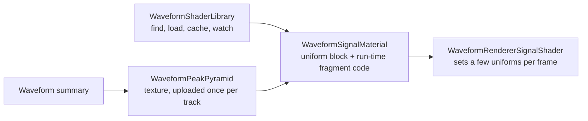

<!-- [AI-generated by Claude — start] -->

# Waveform Shader Packages

* **Owners:**
  * `@v1vendi`

* **Implementation Status:** `Partially implemented` (working prototype, not yet proposed as PRs)

* **Related Issues and PRs:**
  * Bug fixes found while building this, independent of the proposal:
    [v1vendi/mixxx `fix/allshader-hsv-and-stem-gain`](https://github.com/v1vendi/mixxx/tree/fix/allshader-hsv-and-stem-gain)
    (the AllShader HSV renderer ignores the hue of the low color; the AllShader stem renderer applies the overall gain
    twice)

* **Other docs or links:**
  * Prototype branches (to be pushed to v1vendi/mixxx): `pr/waveform-shaders`, `feature/overview-shaders`,
    `experiment/drop-legacy-waveforms`

> TL;DR: Draw the AllShader waveform signal with small GLSL fragment shaders ("shader packages") that Mixxx loads from
> disk at run time, instead of one C++ renderer per waveform type. The stock looks (RGB, HSV, Filtered, RGB Stacked,
> stems, high detail, slip) ship as packages and look the same as today. Skins and users can add their own looks
> without recompiling Mixxx, and saving a shader file reloads it while Mixxx runs. The same packages can also draw the
> deck overview and the library waveform column. The prototype is about 4,000 added lines; this document proposes
> landing it as 8 reviewable PRs of 100–1,000 lines each, in a fixed order, with stock behavior unchanged until a
> separate "make it the default" step.

## Why

A new waveform look today means a new C++ renderer class, a new waveform type in the factory and preferences, and a
new Mixxx release. That is why only a handful of looks exist, why skins can only pick colors, and why requests for
other looks (a different stem layout, a beat-reactive look, a minimal look for small screens) rarely get done.

Each AllShader renderer also builds vertex geometry on the CPU for every pixel column of every frame. In the
prototype, a fragment shader that reads the waveform from a texture draws the same picture with much less work:

| Type (1608×59 widget, Apple M1, µs/frame, min) | Stock | Shader |
| ---------------------------------------------- | ----: | -----: |
| rgb                                            |  72.9 |   20.0 |
| rgb high detail                                | 414.3 |   57.8 |
| hsv                                            | 154.0 |   22.9 |
| filtered                                       | 117.5 |   14.5 |
| filtered high detail                           | 294.5 |   43.5 |
| stacked                                        | 119.8 |   14.7 |
| stacked high detail                            | 426.3 |   51.9 |
| stems                                          |  74.2 |   21.2 |

The stock rows without high detail vary between runs, so they are rough.

### Pitfalls of the current solution

* Every look is C++. Skin authors and users cannot change how the signal is drawn.
* The renderers duplicate the same data access, gain and color code per type, with small differences that drift. Two
  bugs of that kind were found while building this (see Related PRs).
* The CPU cost per frame grows with widget width and with high detail.
* The deck overview and the library waveform column have a third, separate QPainter implementation of the same
  looks.

## Goals

* Draw the AllShader waveform signal with a fragment shader loaded from disk at run time.
* Ship packages that reproduce the stock types (RGB, HSV, Filtered, RGB Stacked, their high detail variants, slip and
  stems). Fewer than 0.02% of pixels differ by more than 10% from the stock renderers for all types except stems,
  which only differ because of the stock gain bug.
* A small, versioned, documented package contract (`contract: 1`) that skin authors can rely on.
* Let a skin choose a package and set its parameters, and let the user override the choice in Preferences.
* Reload a package when its file is saved.
* Keep stock behavior unchanged until the team decides to make packages the default.
* Later: draw the deck overview and the library waveform column with the same packages.

### Audience

Skin authors, users who want a different waveform look, and the maintainers of `src/waveform` and `src/rendergraph`.

## Non-Goals

* Vertex shaders, geometry or multiple passes in packages. A package only colors pixels.
* Drawing beats, cues, loops, the play marker or other marks with packages. Mixxx still draws them on top.
* Support for the scene graph (QML) backend in the first steps. Run-time compiled shaders need the OpenGL rendergraph
  backend. With the scene graph backend, the built-in shader is used (see Open questions).
* A package store, sharing or download inside Mixxx.
* Removing the legacy (non-AllShader) waveform types. The prototype has a branch that does it, but that is a separate
  decision, listed under [Follow-ups](#follow-ups-separate-decisions).

## How

### Overview

* `WaveformPeakPyramid` uploads the track's waveform once, as a texture with per-band peaks at every power-of-two zoom
  level. Each frame only sets uniforms (position, zoom, gains, colors, beat, time).
* `rendergraph::WaveformSignalMaterial` defines the uniform block in one place and compiles fragment code at run time
  on the OpenGL backend. If a package fails to compile, it falls back to the built-in `waveformsignal.frag`.
* `WaveformShaderLibrary` finds packages in `<settings>/waveforms/`, then `<skin>/waveforms/`, then
  `<resources>/waveforms/` (first match wins). It caches them and reloads them when a file changes.
* A package is a directory with `manifest.json` (name, `contract: 1`, up to 16 float parameters) and `waveform.frag`,
  which implements `vec4 waveformColor(WaveformPixel p)` in GLSL 1.20 / ES 1.00. Mixxx provides the helpers
  (`waveformData()`, `waveformPeaks()`, stem helpers), the `WF_*` uniforms and `main()`. The full contract is in
  `res/waveforms/README.md`.
* Selection is `[Waveform] SignalShader`. When it is not set, the skin's choice is used, and if the skin names no
  package, no shaders are used. That keeps stock behavior unchanged. The other values are `off`, `default` (the
  standard package for the type) and a package name.

### Splitting the work

The prototype is 4 commits on top of `main` (about 2,900 added lines) plus 2 for the overviews (about 1,060). One PR of
that size is hard to review. The plan below splits it so that:

* each PR has one reviewer focus (rendergraph, data, renderer, file loading, UI) and can be read in one sitting;
* each PR builds, passes the tests and leaves Mixxx working, with stock behavior unchanged until PR 8;
* from PR 3 on, each PR is used by Mixxx as soon as it is merged.

PR 1 and PR 2 are the exception: they are groundwork with no caller in Mixxx until PR 3. They are split out because
they are reviewed by different people (waveform data, rendergraph) and are easier to judge without the renderer around
them. PR 1 is covered by its own unit tests. Both are only proposed for merging once PR 3 is open and ready for
review, so that unused code does not sit in `main`. If reviewers prefer, PR 1 to PR 3 can instead be merged as one PR
with three commits.

| #   | PR                                                                                         | Area                       | Size (approx.)                       | Depends on   |
| --- | ------------------------------------------------------------------------------------------ | -------------------------- | ------------------------------------ | ------------ |
| 0   | Fix AllShader HSV hue and stem double gain                                                 | allshader                  | 2 one-liners                         | –            |
| 1   | `WaveformPeakPyramid` + unit tests (groundwork, first used by PR 3)                        | waveform data              | ~200 + tests                         | –            |
| 2   | Run-time fragment shaders in rendergraph + `WaveformSignalMaterial` + built-in shader (groundwork, first used by PR 3) | rendergraph | ~500 (+ generated `.gl`) | –            |
| 3   | `WaveformRendererSignalShader` with the built-in shader, behind a hidden config key        | allshader                  | ~550                                 | 1, 2         |
| 4   | Shader packages: contract, `WaveformShaderLibrary`, hot reload, bundled packages, README   | allshader, res             | ~650 + ~500 shader/docs              | 3            |
| 5   | Stems through packages (stem pass, `stems` package)                                        | allshader                  | ~300                                 | 4            |
| 6   | Preferences "Shader" setting and skin `<WaveformShader>` / `<WaveformShaderParam>`         | preferences, skin          | ~150                                 | 4            |
| 7   | Overviews: deck `WOverview` and library column drawn with packages, rendered offscreen      | widget, library            | ~1,060                               | 4            |
| 8   | Make `default` the default value of `SignalShader`                                         | config                     | ~10                                  | 5, 6, 7      |

Details:

* **PR 0** is already prepared and stands alone. It also makes the stock renderers the right reference for the
  pixel comparison in later PRs.
* **PR 1** is pure data code: the peak texture layout and its construction from a `Waveform`. It replaces nothing
  and nothing calls it until PR 3. It has no GL code, so it gets unit tests (peaks per level, odd sizes, partial
  analysis, the stem pyramid, maximum texture size).
* **PR 2** adds `MaterialShader` support for fragment source given at run time (about 50 lines) plus the waveform
  material and its built-in shader. Like PR 1, nothing uses it until PR 3.
* **PR 3** adds the renderer that draws the signal from the texture, using only the built-in Filtered shader. It is
  enabled by a hidden config key, so it ships dark. It is where the performance numbers above can be checked on
  every platform before any file loading exists.
* **PR 4** is the user-visible feature: file format, search paths, contract checks, hot reload, and the bundled
  `rgb`, `hsv`, `filtered` and `stacked` packages with the pixel comparison against the stock renderers. Most of the
  bundled part is short GLSL files and the README.
* **PR 5** moves stems to a package. It is separate because stems have their own uniforms and layering, and their own
  reviewers.
* **PR 6** is UI only.
* **PR 7** is larger, but it only touches `WOverview`, `OverviewCache` and one new file. It reuses PR 1, PR 2 and
  PR 4 unchanged. When shaders are off, overviews use the existing QPainter code. It can be split further into deck
  overview and library column if needed.
* **PR 8** is a one-line policy change, kept separate so that the decision is visible and easy to revert. It should
  land early in a release cycle.

### Testing and verification

* Unit tests for the peak pyramid (PR 1) and for manifest and contract validation (PR 4).
* A pixel comparison of each bundled package against the stock renderer, reported in each PR and runnable locally.
* The performance numbers above, re-measured on Linux and Windows, in PR 3.
* Manual checks: hot reload, broken packages (compile error, bad manifest, missing file) falling back to the built-in
  shader with a log line naming the package, skin-selected packages, and stem tracks.

### Migration

None is needed. Stock behavior is unchanged until PR 8. After PR 8, the bundled packages draw the same picture as the
stock renderers, and `SignalShader off` restores the old renderers.

### Open questions

* **Scene graph / QML.** Run-time GLSL needs the OpenGL rendergraph backend. For the QML interface, packages would need
  to be compiled to QSB at run time (`QShaderBaker`), or the packages limited to the built-in set at build time. Which
  is acceptable?
* **GLSL dialect.** Packages are GLSL 1.20 / ES 1.00 today, so they work on old GL and on GLES. Should the contract use
  a newer dialect instead, which is closer to what QSB would need?
* **Trust.** Packages from a skin or the settings directory run on the GPU driver. A bad shader can hang the GPU on
  some drivers. Is a warning in Preferences enough, or should skin packages need an opt-in?
* **Contract evolution.** The contract is versioned (`contract: 1`). What is the policy for adding uniforms within a
  version versus bumping it?

## Alternatives

1. **Keep C++ renderers and add more types.** No new extension point, but every look still needs C++, a release, and
   factory and preferences changes, and the per-frame CPU cost stays.
2. **Data-driven looks (JSON or skin XML colors and styles), no shaders.** Safer, but it only parameterizes existing
   looks and cannot express new ones (stem layouts, beat-reactive looks).
3. **One large PR.** Fastest for the author, but about 4,000 lines across rendergraph, waveform, library, preferences
   and resources is too much for one review. The split above keeps each PR to one area.
4. **Shaders built at compile time only (QSB, no files on disk).** Works with every rendergraph backend, but it removes
   the main benefit: looks without recompiling.

## Action Plan

* [ ] PR 0: AllShader HSV hue and stem gain fixes
* [ ] Agree on the open questions above, at least scene graph support and GLSL dialect
* [ ] PR 1: `WaveformPeakPyramid` with unit tests (groundwork, merged once PR 3 is ready)
* [ ] PR 2: run-time fragment shaders in rendergraph and `WaveformSignalMaterial` (groundwork, merged once PR 3 is
  ready)
* [ ] PR 3: `WaveformRendererSignalShader` with the built-in shader, behind a hidden config key
* [ ] PR 4: shader packages, library, hot reload, bundled packages and README
* [ ] PR 5: stems through packages
* [ ] PR 6: Preferences setting and skin selection
* [ ] PR 7: overviews and library column drawn with packages
* [ ] PR 8: make `default` the default value of `SignalShader`

### Follow-ups (separate decisions)

These are prototyped but not part of this proposal. Each would need its own discussion.

* **Remove the legacy waveform types** (QPainter "software" widgets, old GL/GLSL widgets, the `deprecated/`
  directories, and the "Use acceleration" preference). This is independent of shaders and could land before or after
  them. In the prototype it removes about 5,700 lines (31% of `src/waveform`, about 3,000 of them never compiled
  today). The binary shrinks by only about 100 KB, and memory use does not change measurably, because those classes
  are never created when an AllShader type is selected. The cost is that systems without OpenGL get an empty waveform
  instead of a software-drawn one.
* **Remove the QPainter overview path after PR 7 and PR 8.** It removes about another 700 lines.
<!-- [AI-generated by Claude — end] -->
